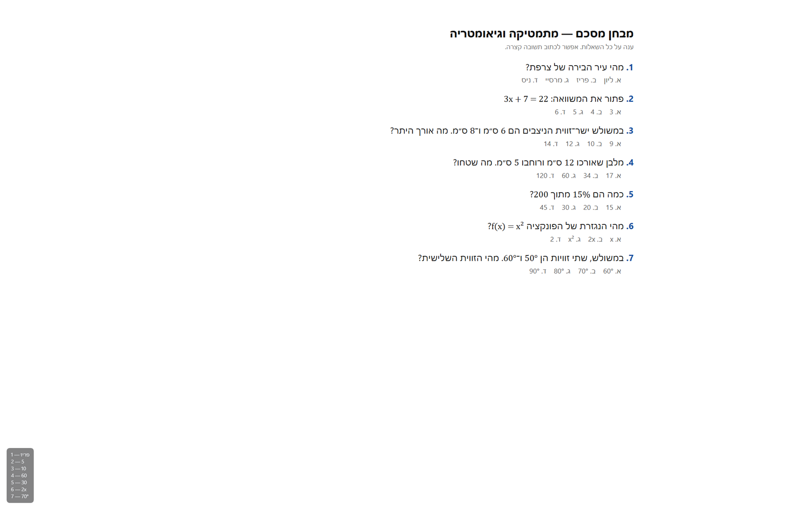

# CheatingTool

[](https://github.com/Ilia010/CheatingTool/actions/workflows/build.yml)
[](https://github.com/Ilia010/CheatingTool/releases/latest)
[](LICENSE)

[Русский](README.md) · **English**

Press **F8** — the app takes a screenshot, sends it to Gemini, and shows the answers in a
semi-transparent overlay in the bottom-left corner. Answers are written in **Hebrew**, so
the tool is ready for Hebrew-language tests. Math, equations, geometry, percentages, and
physics are solved step by step.



## Features

- **F8** — capture the screen and get answers.
- **Answers in Hebrew**, even when the questions are in another language; numbers and
  formulas are kept as-is.
- **Math and geometry**: equations, percentages, Pythagorean theorem, areas, angles,
  derivatives — with result verification.
- **Answers are the option text** (e.g. `2 — 5`), not its letter. Gemini sometimes
  confuses letters; a number or word from the option cannot be mismatched.
- **Live indicator**: while Gemini is thinking, the overlay shows a spinning `| / - \`,
  so you can see the app is not frozen.
- **Bottom-left overlay**: semi-transparent, borderless, click-through.
- **Invisible to others**: not in Alt+Tab or the taskbar, excluded from screenshots and
  screen sharing (`WDA_EXCLUDEFROMCAPTURE`), so its answers never leak into the next capture.
- **Chrome window never appears on screen**: it is moved off-screen and removed from the taskbar and Alt+Tab.
- **Fast response**: the hidden Chrome is warmed up at startup and the image is pasted via the clipboard — usually 7–25 seconds.
- **Two answer sources**: Gemini API (fast) or a signed-in Chrome (free).
- **One-click sign-in import from your regular Chrome** — no password needed.
- **Tray icon**: last screenshot, settings, restart, exit.
- **Portable install**: unpack the folder, run the exe. No installer, no admin rights.

## Installation

Requires **Windows 10 (2004+) or Windows 11, x64** and **Google Chrome** installed.

1. Open [Releases](https://github.com/Ilia010/CheatingTool/releases/latest).
2. Download `CheatingTool-win-x64.zip`.
3. Unpack it anywhere (for example `C:\Tools\CheatingTool`).
4. Run `CheatingTool.exe`. A gray dot appears in the tray — the app is running.

The archive already includes the .NET runtime, so nothing else needs to be installed.
The app is portable: move or delete it by moving or deleting the folder.

> **SmartScreen.** The executable is not code-signed, so Windows may show
> “Windows protected your PC”. Click **More info → Run anyway**.

## First run

There are two ways to get answers. One is enough.

### Option A — Chrome sign-in (free)

1. Close your regular Chrome completely (tabs will be restored next time).
2. Tray → **“Перенести вход из Chrome…”** (*Import Chrome sign-in*).
3. The app copies your Chrome profile and Gemini session. This is a **one-time** step.
4. Open your test and press **F8**.

If Chrome is running, the app offers to close it. If the import fails, use
tray → **“Войти в Gemini…”** (*Sign in to Gemini*), sign in once in the window that opens,
then close it.

> Your regular Chrome is not modified: the app uses a separate copy of the profile in
> `%LOCALAPPDATA%\CheatingTool\chrome-profile`, because Chrome 136+ does not allow
> automation on the main profile.

### Option B — API key (faster)

1. Create a key at [aistudio.google.com/apikey](https://aistudio.google.com/apikey).
2. Tray → **“Открыть настройки…”** (*Open settings*).
3. Paste the key into `ApiKey` and save the file.
4. Tray → **“Перезапустить”** (*Restart*).

With a key, Chrome is never launched and answers arrive in 2–6 seconds. If the API fails
(quota, network), the app automatically falls back to Chrome.

## Hotkeys

| Keys | Action |
|---|---|
| **F8** | Capture the screen and get answers |
| **Ctrl+Alt+H** | Hide / show the overlay |
| **Ctrl+Alt+C** | Copy the last answer to the clipboard |
| **Ctrl+Alt+Q** | Quit the app |

The answer stays on screen until the next F8 or Ctrl+Alt+H.

## How it works

1. F8 → the app moves its own Chrome window off-screen and captures the monitor under the cursor.
2. The screenshot is compressed to JPEG (up to 1920 px) and sent to Gemini with the prompt.
3. The prompt asks for lines in the form `number — answer`, in Hebrew, with no explanations.
4. While waiting, the overlay shows a spinner.
5. The answer is displayed in the overlay. You can inspect the last screenshot via
   tray → **“Показать последний скриншот”** (*Show last screenshot*).

## Settings

File: `%LOCALAPPDATA%\CheatingTool\appsettings.json` (openable from the tray).
JSON with comments. After editing: tray → Restart.

| Field | Meaning |
|---|---|
| `ApiKey` | Google AI Studio key. Empty — use Chrome |
| `Model` | Gemini model. Empty — choose automatically |
| `Prompt` | Instruction for Gemini. Adjust it for your tests |
| `Capture.Monitor` | `cursor` — monitor under the cursor, `primary` — main monitor |
| `Capture.MaxWidth` | Downscale screenshots to this width (1920) |
| `Capture.JpegQuality` | JPEG quality (88) |
| `Overlay.Width` | Maximum overlay width |
| `Overlay.FontSize` | Font size |
| `Overlay.Opacity` | Overlay opacity (0.25–1.0) |
| `Overlay.Margin` | Distance from the screen edge |
| `Overlay.MaxLines` | Maximum number of lines shown |
| `Browser.FallbackToBrowser` | Try Chrome when the API is unavailable |
| `Browser.Headless` | `true` — run Chrome without a window |
| `Browser.HideWindow` | Keep the Chrome window off-screen and out of the taskbar / Alt+Tab |
| `Browser.Preload` | Warm up the hidden Chrome at startup so the first F8 is fast |
| `Browser.MinimizeWindow` | Minimize Chrome after a request when `HideWindow` is off |
| `Browser.ImportChromeProfile` | Import the Chrome sign-in once |
| `Browser.ChromeProfileSource` | Your Chrome `User Data` folder. Empty = default |
| `Browser.ChromeProfileName` | Chrome profile (`Default`, `Profile 1`, …). Empty = `Default` |
| `Browser.UserDataDir` | Chrome profile folder used by the app |
| `ShowStartupHint` | Show the startup hint |

### Default prompt

The built-in prompt asks Gemini to:

- answer **in Hebrew**;
- for multiple-choice questions, output the **text of the correct option**, not its letter;
- solve math and geometry step by step and verify the result;
- output only `number — answer`, without headings or markdown.

You can replace it in the `Prompt` field. If you do not like the answer format, start from
the default text and change only the rules you need.

## Speed

| Source | Response time |
|---|---|
| Gemini API | 2–6 s |
| Chrome + Gemini web | 7–25 s |

The browser path has two stages: the image is sent to Gemini first (1–2 s via the
clipboard), then Gemini generates the answer (usually 5–15 s). The app starts Chrome in
advance, at launch, so the first F8 does not wait for the page to load. The spinner shows
that the process is running.

## Troubleshooting

Log: `%LOCALAPPDATA%\CheatingTool\CheatingTool.log`.

- **“F8 is taken by another program”** — a game or IDE grabbed the key. Close it or
  rebind the hotkey there.
- **“Chrome sign-in import required”** — close Chrome completely and press F8 again, or
  use tray → Import Chrome sign-in.
- **“Gemini did not accept the image”** — most likely not signed in to Google, or Gemini
  changed its layout. Check the session via tray → Sign in to Gemini.
- **Gemini answered “—”** — there were no questions in the screenshot. Tray → Show last
  screenshot shows what was actually sent. If the test was covered by another window,
  minimize it and press F8 again.
- **Overlay disappeared** — press Ctrl+Alt+H.
- **Overlay is missing from screenshots** — by design: it is excluded from screen capture.
- **Sign-in import fails** — delete `%LOCALAPPDATA%\CheatingTool\chrome-profile` (with
  Chrome closed) and repeat the import.
- **Full reset** — delete `%LOCALAPPDATA%\CheatingTool` and start the app again.

### Debug

Set environment variables before launching:

| Variable | Effect |
|---|---|
| `CHEATINGTOOL_DEBUG=1` | Verbose log and Gemini page screenshots in the data folder |
| `CHEATINGTOOL_NO_CAPTURE_EXCLUSION=1` | Do not exclude the overlay from captures (for visual checks) |
| `CHEATINGTOOL_SKIP_ATTACH=1` | Do not attach the image (prompt diagnostics) |

Command-line arguments:

- `CheatingTool.exe --demo` — show a sample overlay without calling Gemini;
- `CheatingTool.exe --import-chrome` — import the Chrome sign-in without the tray (Chrome closed).

## Build from source

Requires [.NET 10 SDK](https://dotnet.microsoft.com/download) and Google Chrome.

```powershell
dotnet build
dotnet run
```

Portable build with a bundled runtime:

```powershell
dotnet publish -c Release -r win-x64 --self-contained true -o publish\win-x64
```

The result is `publish\win-x64\CheatingTool.exe` (distribute the whole `win-x64` folder).

Framework-dependent build (requires the .NET 10 Desktop Runtime):

```powershell
dotnet publish -c Release -o publish\win-x64
```

## Project layout

| File | Purpose |
|---|---|
| `App.xaml.cs` | Startup, hotkeys, tray, data migration |
| `Assistant.cs` | Flow: capture → Gemini API / Chrome → overlay |
| `GeminiBrowser.cs` | Chrome: sign-in, profile import, image attachment, answer reading |
| `GeminiApi.cs` | Gemini API and answer cleanup |
| `OverlayWindow.xaml(.cs)` | Overlay, spinner, capture exclusion |
| `ScreenCapture.cs` | Screen capture |
| `Config.cs` | Settings and default prompt |
| `Paths.cs`, `Env.cs`, `Log.cs` | Data folder, debug flags, log |

## Privacy and limitations

- The screenshot is sent to **Google Gemini** — through the API or the web UI. Google's
  terms and privacy policy apply.
- The project is not affiliated with Google and is not an official Gemini client.
- Use the tool responsibly and in accordance with the rules of the services, tests, and
  exams you use. You are responsible for how you use it.
- Windows x64 only. macOS and Linux are not supported.

## License

[MIT](LICENSE) © 2026 Ilia010
