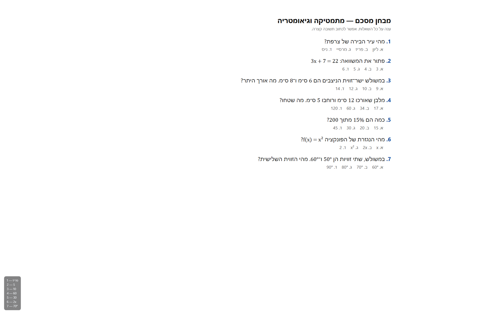

# CheatingTool

[](https://github.com/Ilia010/CheatingTool/actions/workflows/build.yml)
[](https://github.com/Ilia010/CheatingTool/releases/latest)
[](LICENSE)

**Русский** · [English](README.en.md)

Нажимаешь **F8** — программа снимает экран, отправляет снимок в Gemini и показывает
ответы в полупрозрачной плашке в левом нижнем углу. Ответы пишутся **на иврите**,
поэтому программа подходит для ивритоязычных тестов. Математика, уравнения,
геометрия, проценты и физика решаются по шагам.



## Возможности

- **F8** — снять экран и получить ответы.
- **Ответы на иврите**, даже если задание на другом языке; числа и формулы не переводятся.
- **Математика и геометрия**: уравнения, проценты, теорема Пифагора, площади, углы,
  производные — с проверкой результата.
- **Ответ — сам текст варианта** (например, `2 — 5`), а не буква. Буквы Gemini иногда
  путает, а число или слово варианта ошибиться не даёт.
- **Живой индикатор**: пока Gemini думает, в плашке крутится `| / - \` — видно, что
  программа не зависла.
- **Плашка снизу слева**: полупрозрачная, без рамки, клики проходят сквозь неё.
- **Невидима для окружающих**: нет в Alt+Tab и на панели задач, исключена из скриншотов
  и демонстрации экрана (`WDA_EXCLUDEFROMCAPTURE`), поэтому её ответы не попадают
  в следующий снимок.
- **Окно Chrome не появляется на экране**: оно уведено за границы экрана и убрано из панели задач и Alt+Tab.
- **Быстрый отклик**: скрытый Chrome прогревается при запуске, картинка вставляется через буфер обмена — обычно 7–25 секунд.
- **Два источника ответа**: Gemini API (быстро) или залогиненный Chrome (бесплатно).
- **Перенос входа из обычного Chrome** одной кнопкой — один раз, без ввода пароля.
- **Трей-иконка**: последний отправленный скриншот, настройки, перезапуск, выход.
- **Портативная установка**: распаковал папку — запустил exe. Без установщика и без прав администратора.

## Установка

Нужны **Windows 10 (2004+) или Windows 11, x64** и установленный **Google Chrome**.

1. Открой [Releases](https://github.com/Ilia010/CheatingTool/releases/latest).
2. Скачай `CheatingTool-win-x64.zip`.
3. Распакуй архив в любую папку (например, `C:\Tools\CheatingTool`).
4. Запусти `CheatingTool.exe`. В трее появится серая точка — программа работает.

В архиве уже лежит .NET Runtime, отдельно ничего ставить не нужно. Приложение portable —
его можно переносить и удалять простым удалением папки.

> **SmartScreen.** Файл не подписан цифровой подписью, поэтому Windows может показать
> «Windows защитила ваш компьютер». Нажми **«Подробнее» → «Выполнить в любом случае»**.

## Первый запуск

Ответы можно получать двумя способами. Достаточно настроить один.

### Вариант А — вход из Chrome (бесплатно)

1. Полностью закрой обычный Chrome (вкладки восстановятся при следующем запуске).
2. Трей → **«Перенести вход из Chrome…»**.
3. Программа скопирует профиль и вход в Gemini. Это делается **один раз**.
4. Открой тест и нажми **F8**.

Если Chrome был открыт, программа сама предложит его закрыть. Если перенос не сработал —
трей → **«Войти в Gemini…»**, войди один раз в открывшемся окне и закрой его.

> Свой Chrome программа не трогает: она использует отдельную копию профиля в
> `%LOCALAPPDATA%\CheatingTool\chrome-profile`, потому что Chrome с 136-й версии
> не разрешает управлять собой на основном профиле.

### Вариант Б — API-ключ (быстрее)

1. Создай ключ на [aistudio.google.com/apikey](https://aistudio.google.com/apikey).
2. Трей → **«Открыть настройки…»**.
3. Вставь ключ в поле `ApiKey`, сохрани файл.
4. Трей → **«Перезапустить»**.

С ключом Chrome вообще не запускается, ответ приходит за 2–6 секунд. Если API вернул
ошибку (лимит, сеть), программа автоматически попробует Chrome.

## Горячие клавиши

| Клавиши | Действие |
|---|---|
| **F8** | Снять экран и получить ответы |
| **Ctrl+Alt+H** | Скрыть / показать плашку |
| **Ctrl+Alt+C** | Скопировать последний ответ в буфер обмена |
| **Ctrl+Alt+Q** | Выйти из программы |

Ответ висит до следующего F8 или до Ctrl+Alt+H.

## Как это работает

1. F8 → программа убирает своё окно Chrome за пределы экрана и делает снимок монитора под курсором.
2. Снимок сжимается в JPEG (до 1920 px) и отправляется в Gemini вместе с промтом.
3. Промт просит вывести только строки `номер — ответ`, на иврите, без пояснений.
4. Пока ждём ответ, в плашке крутится спиннер.
5. Готовый ответ показывается в плашке. Последний отправленный снимок можно посмотреть:
   трей → **«Показать последний скриншот»**.

## Настройки

Файл: `%LOCALAPPDATA%\CheatingTool\appsettings.json` (открывается из трея).
Формат — JSON с комментариями. После правки: трей → «Перезапустить».

| Поле | Что делает |
|---|---|
| `ApiKey` | Ключ Google AI Studio. Пусто — работа через Chrome |
| `Model` | Модель Gemini. Пусто — выбрать автоматически |
| `Prompt` | Инструкция для Gemini. Меняй под свои тесты |
| `Capture.Monitor` | `cursor` — монитор под курсором, `primary` — основной |
| `Capture.MaxWidth` | До какого размера сжимать снимок (1920) |
| `Capture.JpegQuality` | Качество JPEG (88) |
| `Overlay.Width` | Максимальная ширина плашки |
| `Overlay.FontSize` | Размер текста |
| `Overlay.Opacity` | Прозрачность плашки (0.25–1.0) |
| `Overlay.Margin` | Отступ от края экрана |
| `Overlay.MaxLines` | Сколько строк максимум показывать |
| `Browser.FallbackToBrowser` | Пробовать Chrome, если API недоступен |
| `Browser.Headless` | `true` — Chrome без окна |
| `Browser.HideWindow` | Держать окно Chrome за пределами экрана и вне панели задач / Alt+Tab |
| `Browser.Preload` | Прогревать скрытый Chrome при запуске, чтобы первый F8 был быстрым |
| `Browser.MinimizeWindow` | Сворачивать Chrome после запроса, если `HideWindow` выключен |
| `Browser.ImportChromeProfile` | Один раз перенести вход из обычного Chrome |
| `Browser.ChromeProfileSource` | Папка `User Data` твоего Chrome. Пусто = стандартная |
| `Browser.ChromeProfileName` | Профиль Chrome (`Default`, `Profile 1`, …). Пусто = `Default` |
| `Browser.UserDataDir` | Папка профиля Chrome программы |
| `ShowStartupHint` | Показывать подсказку при запуске |

### Промт по умолчанию

Просит Gemini:

- отвечать **на иврите**;
- для вопросов с вариантами выводить **текст правильного варианта**, а не букву;
- решать математику и геометрию по шагам и проверять результат;
- писать только `номер — ответ`, без заголовков и markdown.

Свой промт можно написать в поле `Prompt`. Если формат ответа не нравится, начни с
текста по умолчанию и меняй только нужные правила.

## Скорость

| Источник | Время ответа |
|---|---|
| Gemini API | 2–6 с |
| Chrome + Gemini web | 7–25 с |

Браузерный режим работает в два этапа: сначала картинка уходит в Gemini (1–2 с через
буфер обмена), затем Gemini генерирует ответ (обычно 5–15 с). Chrome программа
запускает заранее, ещё при старте, поэтому первый F8 не ждёт загрузки страницы.
Спиннер показывает, что процесс идёт.

## Если что-то не так

Лог: `%LOCALAPPDATA%\CheatingTool\CheatingTool.log`.

- **«F8 занята другой программой»** — игру/IDE перехватили клавишу. Закрой их или
  переназначь хоткей в их настройках.
- **«Нужно один раз перенести вход из Chrome»** — закрой Chrome полностью и нажми F8
  ещё раз, либо трей → «Перенести вход из Chrome…».
- **«Gemini не принял картинку»** — скорее всего, нет входа в аккаунт Google или Gemini
  изменил вёрстку. Проверь вход через трей → «Войти в Gemini…».
- **Gemini ответил «—»** — на снимке не было вопросов. Трей → «Показать последний
  скриншот» покажет, что именно ушло. Если тест перекрыт другим окном — сверни его и
  нажми F8 ещё раз.
- **Плашка пропала** — нажми Ctrl+Alt+H.
- **Плашки не видно на скриншоте** — так и задумано: она исключена из захвата экрана.
- **Не работает перенос входа** — удали `%LOCALAPPDATA%\CheatingTool\chrome-profile`
  (Chrome должен быть закрыт) и повтори перенос.
- **Хочу сбросить всё** — удали папку `%LOCALAPPDATA%\CheatingTool` и запусти программу заново.

### Отладка

Флаги задаются переменными окружения перед запуском:

| Переменная | Что делает |
|---|---|
| `CHEATINGTOOL_DEBUG=1` | Подробный лог и снимки страницы Gemini в папке данных |
| `CHEATINGTOOL_NO_CAPTURE_EXCLUSION=1` | Не исключать плашку из скриншотов (для проверки вида) |
| `CHEATINGTOOL_SKIP_ATTACH=1` | Не прикреплять картинку (диагностика текста промта) |

Аргументы командной строки:

- `CheatingTool.exe --demo` — показать пример плашки без запроса к Gemini;
- `CheatingTool.exe --import-chrome` — перенести вход из Chrome без трея (Chrome закрыт).

## Сборка из исходников

Нужен [.NET 10 SDK](https://dotnet.microsoft.com/download) и Google Chrome.

```powershell
dotnet build
dotnet run
```

Портативная сборка со встроенным рантаймом:

```powershell
dotnet publish -c Release -r win-x64 --self-contained true -o publish\win-x64
```

Готовый файл: `publish\win-x64\CheatingTool.exe` (всю папку `win-x64` нужно распространять целиком).

Сборка без встроенного рантайма (нужен .NET 10 Desktop Runtime):

```powershell
dotnet publish -c Release -o publish\win-x64
```

## Структура проекта

| Файл | Назначение |
|---|---|
| `App.xaml.cs` | Запуск, горячие клавиши, трей, миграция данных |
| `Assistant.cs` | Сценарий: снимок → Gemini API / Chrome → плашка |
| `GeminiBrowser.cs` | Chrome: вход, импорт профиля, прикрепление картинки, чтение ответа |
| `GeminiApi.cs` | Gemini API и очистка ответа |
| `OverlayWindow.xaml(.cs)` | Плашка, спиннер, исключение из скриншотов |
| `ScreenCapture.cs` | Снимок экрана |
| `Config.cs` | Настройки и промт по умолчанию |
| `Paths.cs`, `Env.cs`, `Log.cs` | Папка данных, флаги отладки, лог |

## Приватность и ограничения

- Скриншот отправляется в **Google Gemini** — через API или веб-интерфейс. На него
  распространяются правила и политика Google.
- Программа не связана с Google и не является официальным клиентом Gemini.
- Используй инструмент ответственно и с учётом правил сервисов, тестов и экзаменов.
  Ответственность за использование лежит на пользователе.
- Поддерживаются только Windows x64. macOS и Linux не поддерживаются.

## Лицензия

[MIT](LICENSE) © 2026 Ilia010
